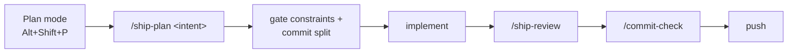

# ship-review

Agent Skills that stop a change from bouncing at review.

Two skills and four slash commands that catch the class of defect reviewers most often send back:
unvalidated boundaries, one rule implemented twice, magic literals, half-finished enums, and broken
cross-layer contracts. Plus the commit discipline that makes a pull request reviewable.

Derived from a real code review where exactly these defects blocked a merge.

## What this is

A portable **Agent Plugins** package. `plugin.json` carries the metadata, `skills/` carries the
capability. The two skills are the artifact; they work in any host that reads Agent Skills:
a folder with `SKILL.md` and `name` plus `description` frontmatter.

| Artifact | Standard | Contents |
|---|---|---|
| `plugin.json` | [Agent Plugins 1.0.0](https://agent-plugins.org/schemas/1.0.0/plugin.schema.json) | name, version, description, author, license, keywords |
| `skills/<name>/SKILL.md` | Agent Skills | the two skills |
| `commands/*.md` | host extension | four slash commands for hosts that support them |
| `package.json` | `oh-my-pi` adapter | `private: true`, no publish target |

`index.cjs` exists only because oh-my-pi's extension-package loader requires a `package.json` entry
before it scans sibling directories. It registers no behavior. A host that reads `plugin.json` and
`skills/` directly ignores it.

`plugin.json` and `package.json` cannot derive from each other, so `name`, `version`, `description`,
and `license` are duplicated by necessity. `npm run check` is the single invariant that keeps them
from drifting:

```bash
npm run check    # fails on any mismatch between the two manifests
```

## Install

Portable (any host with Agent Skills support): copy `skills/` into that host's skills directory, or
point it at this checkout. Nothing else is required.

oh-my-pi (adds the slash commands):

```bash
git clone https://github.com/DANANGG28/ship-review.git
omp plugin link "$PWD/ship-review"
```

Verify:

```bash
omp plugin doctor        # 0 errors
omp skill list           # boundary-and-ssot, commit-hygiene
```

Skills and commands load when a session starts, so restart after installing.

## Usage

| Command | When | What it does |
|---|---|---|
| `/ship-plan <intent>` | Plan mode, before writing code | Turns the intent into gate constraints and an exact commit split. Read-only. |
| `/ship-review [target]` | Before pushing | Full nine-gate review with numbered findings, severity, verdict, next action. |
| `/boundary [target]` | Reviewing a diff | The six boundary and SSOT gates only. |
| `/commit-check` | Before committing | Audits the staged set: scope, size, secrets, message, scaffolding. Proposes the commit split. |

`[target]` accepts a path, a PR (`pr://1`), or nothing, which means the current working-tree diff.

The two skills also load on their own when a task touches a field, enum, validation rule, or commit.

### Plan mode workflow



`/ship-plan` writes nothing, so it is safe inside plan mode's read-only restriction.

## Skills

### `boundary-and-ssot`

Use when adding or changing a data field, enum, predicate, validation rule, or anything that crosses
a layer boundary. Seven gates:

1. Validate at the boundary, never cast. A DB row, request body, CSV cell, env var, or upstream
   response is `unknown` until a guard or decoder proves it.
2. One rule, one function. A normalization or predicate lives in exactly one place.
3. Symmetric entry points. Single/bulk, HTTP/job, sync/async run identical rules.
4. No magic literals. Counts, ranges, thresholds, and keys are named or read from settings.
5. Complete the declared domain, and build no presumptive surface (YAGNI). Every declared variant
   has a producer, or the type is narrowed; every new abstraction, parameter, field, export, or flag
   has a current caller. YAGNI covers presumptive capability only, never a test, a guard, or a
   cleanup.
6. Propagate across every layer. Domain, schema, migration, repository, IO schema, use case, job,
   and every form agree on required versus optional.
7. Test the branch you added.

Worked examples from the review that produced it: `skills/boundary-and-ssot/references/PATTERNS.md`.

### `commit-hygiene`

Use when committing, splitting work, or opening a pull request. One logical change per commit, small
reviewable diffs, Conventional Commits, scope discipline, no drive-by refactors, no committed
secrets, no scaffolding in the shipped commit.

## Why this exists

A change can pass `typecheck`, `lint`, and its own unit tests and still be rejected, because the
defects that matter are not type errors:

| Defect | Why tests missed it |
|---|---|
| A DB row cast with `as` into a domain type | Compiles; corrupt data fails far away, or not at all |
| The same normalization on one entry point and not the other | The single-path test passes; the bug needs two callers |
| A count hardcoded in a prompt, a type, and a comparison | Each site looks correct alone |
| An enum variant declared, never produced, never tested | The type checker is satisfied by a declaration |
| An API field made optional while its form stayed required | Server tests pass; no user can submit |
| A giant first commit | Nothing fails; the reviewer cannot read it |
| A real `.env` committed with the feature | Nothing fails; the credential is already public |

Each gate above maps to one of these.

## Layout

```
ship-review/
├── plugin.json                   Agent Plugins manifest
├── skills/
│   ├── boundary-and-ssot/
│   │   ├── SKILL.md
│   │   └── references/PATTERNS.md
│   └── commit-hygiene/
│       └── SKILL.md
├── commands/                     host extension
│   ├── ship-plan.md
│   ├── ship-review.md
│   ├── boundary.md
│   └── commit-check.md
├── scripts/check-manifests.mjs   manifest drift check
├── package.json                  oh-my-pi adapter (private)
├── index.cjs                     oh-my-pi adapter entry
├── README.md
└── LICENSE
```

## Verification

Each command was exercised end to end against a repository with deliberately planted defects:

| Command | Input | Result |
|---|---|---|
| `/boundary` | file with a blind cast, asymmetric normalization, unproduced enum variant | all three found, with trigger inputs and fixes |
| `/ship-review` | staged `.env.development` with a credential plus the same defects | 10 findings, credential flagged HIGH, verdict `Not shippable` |
| `/ship-plan` | intent only | gate constraints plus a 5-commit split plan; `git status` unchanged before and after |

## License

MIT
